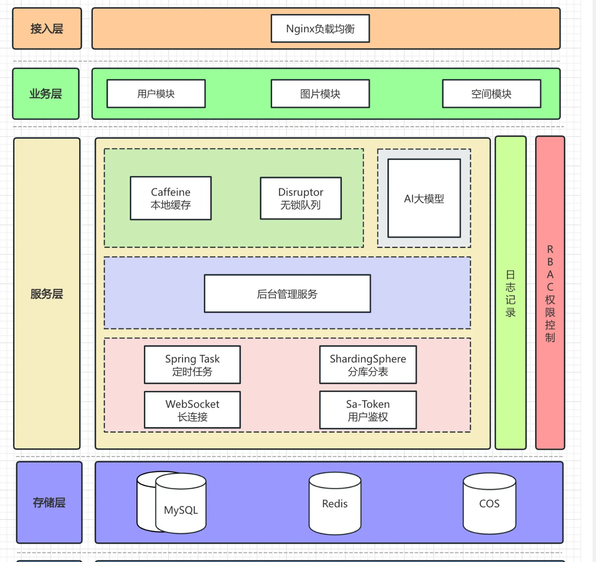
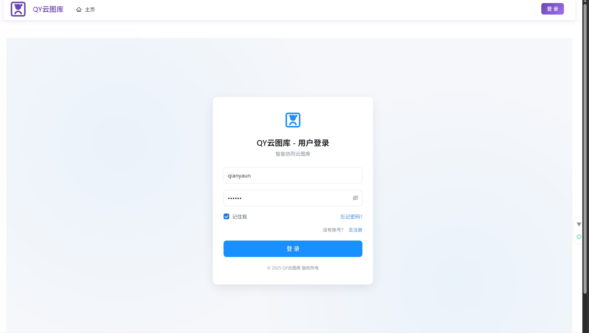
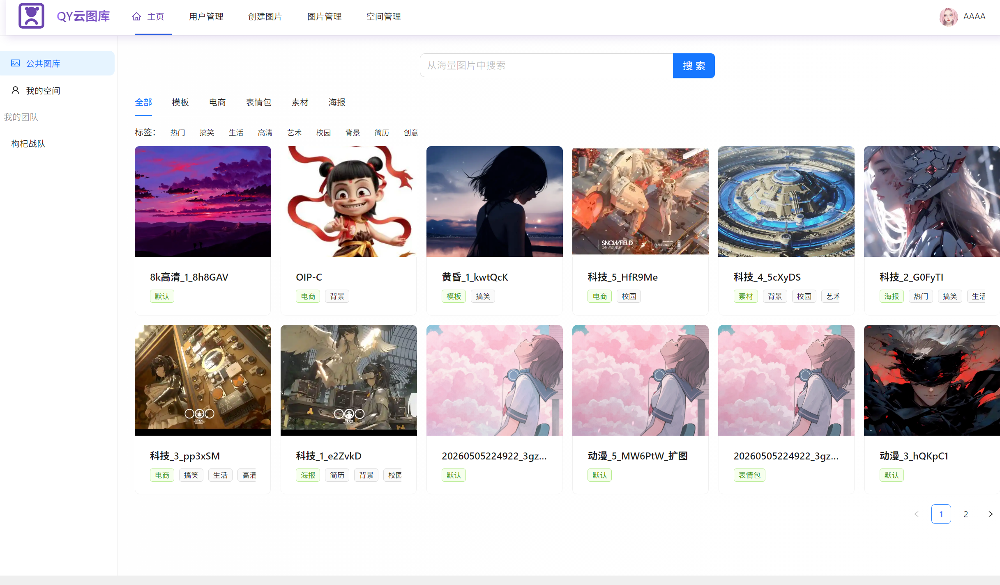
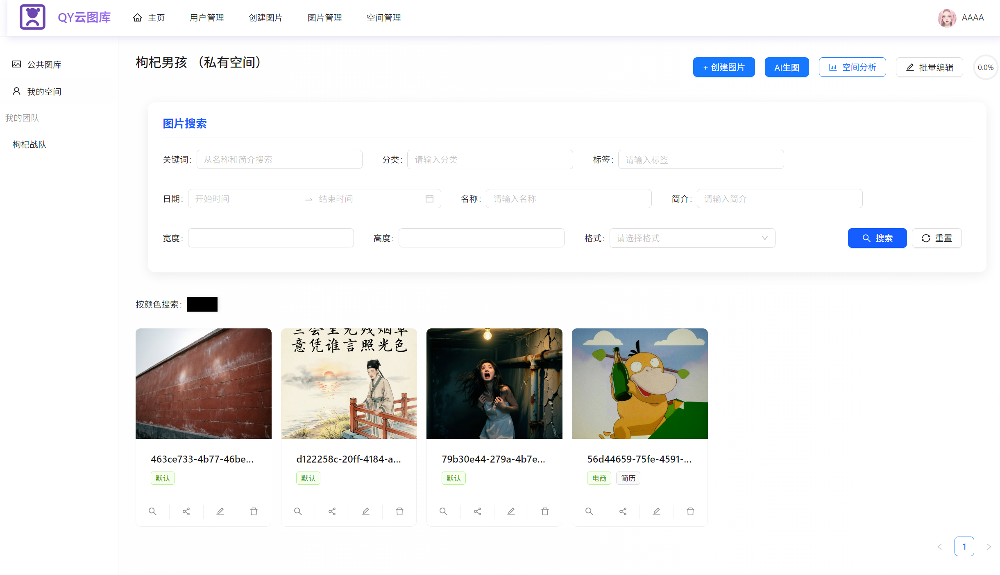
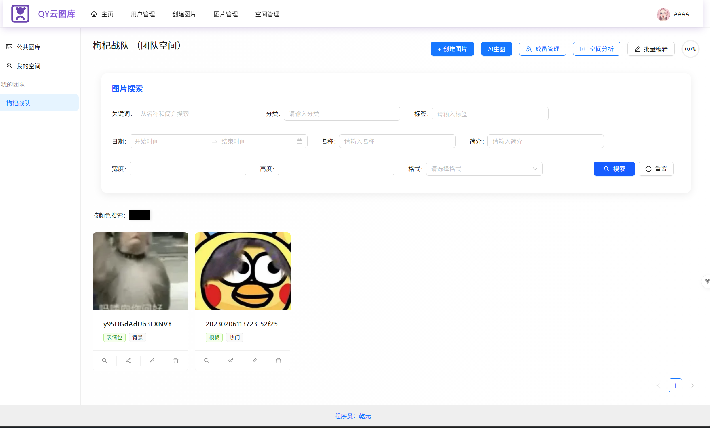
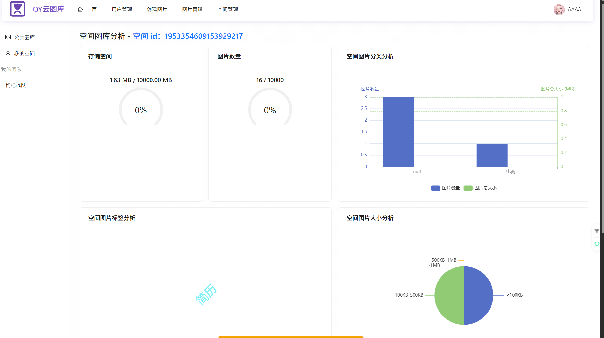
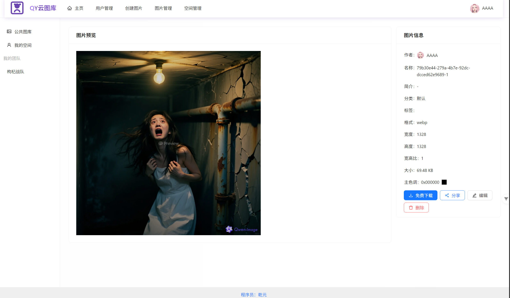
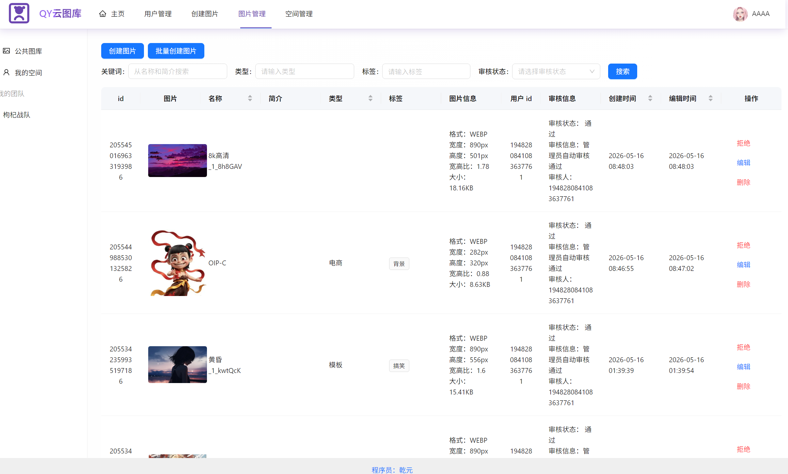
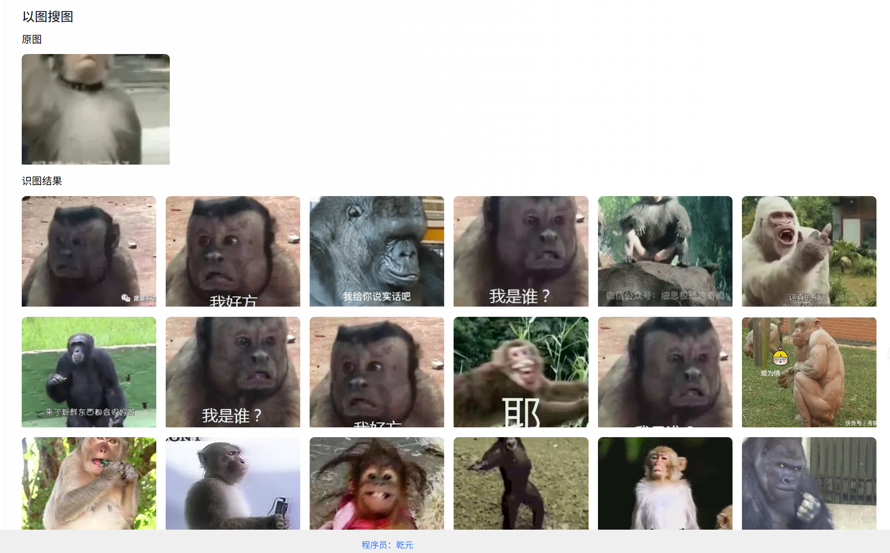
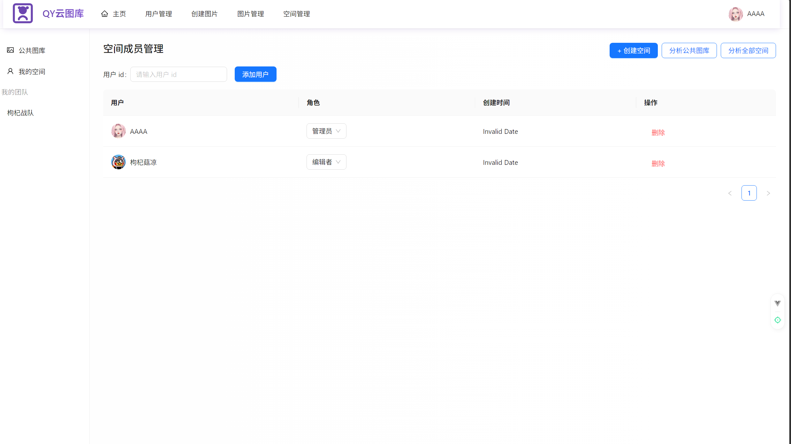

# QY云图库 — 智能协同云图库系统

基于 Spring Boot 2 + MyBatis-Plus 技术栈构建的企业级云图库管理系统，支持公共图库、私有空间、团队协作、图片审核、以图搜图、空间分析及 WebSocket 协同编辑等核心功能，为个人和团队提供高效的图片资源管理解决方案。

## 1、项目技术栈选型

* **Spring Boot 2.7 框架、Maven 构建工具、Java 16**
* **MySQL 数据库 + MyBatis-Plus 持久层框架**
* **腾讯云 COS 对象存储**
* **⭐Redis 分布式缓存 + Caffeine 本地缓存**
* **⭐Spring Session + Redis 会话管理**
* **⭐Jsoup 图片元信息解析**
* **⭐Knife4j + OpenAPI 2 接口文档**
* **⭐模板方法模式（图片上传抽象类）**
* **编程式事务、自定义 AOP 权限拦截**
* **雪花算法分布式 ID 生成**
* **Hutool 工具类库**

## 2、项目架构图

架构采用分层设计：接入层（Nginx 负载均衡）→ 业务层（用户/图片/空间三大模块）→ 服务层（缓存、审核、后台管理、定时任务、WebSocket 长连接等）→ 存储层（MySQL + Redis + COS），横切关注点包括日志记录与 RBAC 权限控制。

## 3、项目业务流程

图片上传与审核业务流程源文件见 [document/图片上传审核流程.puml](document/图片上传审核流程.puml)。

用户上传图片（文件/URL）→ 模板方法统一处理 → 校验格式与大小 → 上传 COS → Jsoup 解析元信息 → 创建 Picture 记录（待审核）→ 管理员审核（通过/拒绝）→ 图片进入公共图库或空间 → 支持以图搜图、颜色搜索、协同编辑。

## 4、项目部分功能展示

### 登录注册

简洁的登录界面，支持账号密码登录，记住我功能。

### 公共图库首页

公共图库首页支持分类筛选（模板/电商/表情包/素材/海报）、标签筛选（热门/搞笑/生活/高清/艺术等）、关键词搜索，左侧导航可切换公共图库、我的空间、我的团队。

### 私有空间

用户私有空间支持多条件组合搜索（关键词/分类/标签/日期/名称/简介/宽度/高度/格式），支持按颜色搜索图片，每张图片提供搜索、分享、编辑、删除操作。

### 团队空间

团队空间支持成员协作，空间管理员可进行成员管理、空间分析、批量编辑，团队成员共享图片资源。

### 空间分析

空间分析面板展示存储空间使用进度、图片数量进度、图片分类分析（柱状图）、标签分析（词云）、图片大小分布（饼图）等多维度数据可视化。

### 图片详情

图片详情页左侧大图预览，右侧展示完整元信息（作者/名称/简介/分类/标签/格式/宽高/体积/主色调），支持免费下载、分享、编辑、删除操作。

### 图片管理与审核

管理员可在图片管理页面查看所有图片的审核状态，支持拒绝、编辑、删除操作，展示图片完整信息（格式/宽高/体积/审核人/审核时间）。

### 以图搜图

上传或选择一张原图，系统自动识别并返回相似图片列表，支持基于内容的反向图片搜索。

### 空间成员管理

空间管理员可添加成员、分配角色（管理员/编辑者）、移除成员，支持团队协作权限管理。

### WebSocket 协同编辑

基于 WebSocket 实现多人实时协同编辑，支持图片裁剪、向左/向右旋转、放大、缩小操作，编辑状态实时同步，协同连接状态实时可见。

## 5、数据库表结构

详见 [sql/table.sql](sql/table.sql)，包含以下核心表：

- `user` — 用户表（账号、密码、角色、头像、会员信息、分享码、邀请关系等）
- `space` — 空间表（空间名称、级别、容量上限、当前用量、创建者等）
- `picture` — 图片表（URL、缩略图、名称、分类、标签、元信息、审核状态、审核人等）

## 6、快速开始

### 环境要求

- JDK 16+
- Maven 3.6+
- MySQL 8.0+
- Redis 6.0+

### 启动步骤

1. 克隆项目：`git clone https://gitee.com/beginning-of-qianyuan/qypicture.git`
2. 创建数据库并执行 `sql/table.sql` 初始化表结构
3. 修改 `src/main/resources/application.yml` 中的数据库和 Redis 配置
4. 配置腾讯云 COS 密钥
5. 启动项目：`mvn spring-boot:run`
6. 访问接口文档：`http://localhost:8123/api/doc.html`
